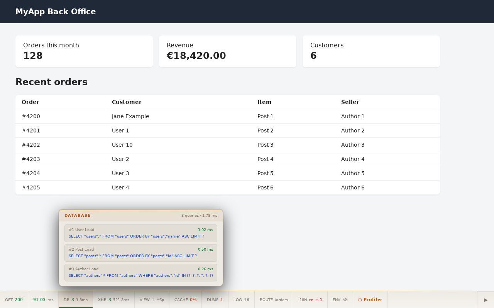
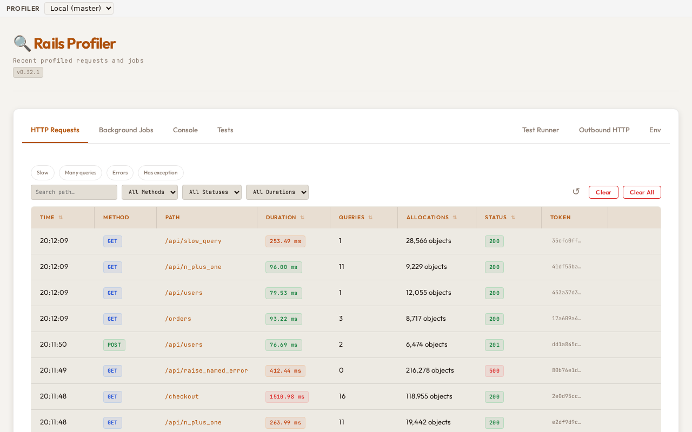
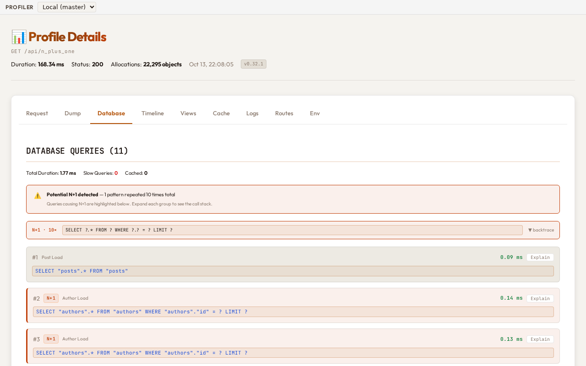
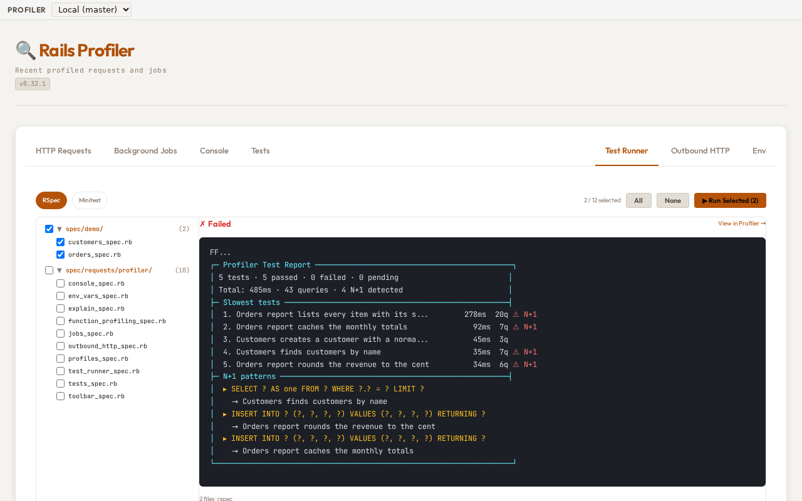

# Rails Profiler

A Rails profiler with a debug toolbar on every page, a dashboard to inspect past requests, jobs,
console expressions and tests, SQL analysis with N+1 detection and query plans, a flame graph
timeline with function profiling, and an MCP server for AI-assisted debugging.



## Features

- **Web Debug Toolbar**: a bar at the bottom of every HTML page with the metrics of the request
- **Profiler Dashboard**: every past request, job, console expression and test, tab by tab
- **Database Profiling**: SQL queries, execution time, N+1 detection, EXPLAIN of read-only queries
- **Flame Graph**: hierarchical timeline of all instrumented events (controller, view, SQL, cache,
  HTTP, custom)
- **Function Profiling**: the Ruby methods a request spends its time in, sampled with the optional
  `stackprof` gem or traced in full
- **View Rendering**: template and partial rendering times
- **Cache Monitoring**: hit and miss rates, reads, writes, deletes
- **AJAX Tracking**: the `fetch()` and `XMLHttpRequest` calls of a page, linked to it, Turbo
  Frame and Turbo Stream requests included
- **Outbound HTTP Tracking**: external API calls via `Net::HTTP`, bodies included
- **Mailers**: every mail delivered or queued, with its body on demand
- **Log Capture**: Rails logger output per request with level filtering
- **I18n Tracking**: translation lookups and missing key detection
- **Background Jobs**: Sidekiq and ActiveJob profiling
- **Console Profiling**: every expression evaluated in `rails console`
- **Environment Overrides**: change `ENV` from the dashboard or MCP, without a restart
- **Test Profiling**: per-test SQL, cache and exception capture for RSpec and Minitest, and a test
  runner in the dashboard
- **MCP Server**: 21 tools and 7 resources for AI assistants, over stdio or HTTP
- **Cluster (Master/Slave)**: one dashboard and one MCP server for several applications
- **Sensitive Data Masking**: your `filter_parameters` applied before anything is stored

## Requirements

- Ruby >= 3.0 (the CI runs the suite on Ruby 3.3 and 3.4)
- Rails >= 7.1

## Installation

Add to your `Gemfile`:

```ruby
gem "rails-profiler", require: "profiler"
```

The library is `profiler`, not `rails-profiler`: without `require: "profiler"`, Bundler loads
nothing of the gem. Then run `bundle install`.

> The gem is published on [RubyGems.org](https://rubygems.org/gems/rails-profiler). Pre-release (canary) versions are available via the [GitLab Package Registry](https://git.duplessy.eu/sebastien/rails-profiler-gem/-/packages):
>
> ```ruby
> source "https://git.duplessy.eu/api/v4/projects/sebastien%2Frails-profiler-gem/packages/rubygems" do
>   gem "rails-profiler", "~> 0.1.0.pre", require: "profiler"
> end
> ```

Mount the engine in `config/routes.rb`:

```ruby
Rails.application.routes.draw do
  mount Profiler::Engine, at: '/_profiler' if Rails.env.development?
end
```

### Optional gems

The profiler depends on none of these; add the ones you use to your application's `Gemfile`:

| Gem | For |
|---|---|
| `stackprof` | Function profiling in its default, low-overhead mode (see [Function profiling](#function-profiling)) |
| `sqlite3` | `config.storage = :sqlite` |
| `redis` (5.x) | `config.storage = :redis` |

## Configuration

Out of the box the profiler is enabled in development and test, stores profiles as files under
`tmp/rails-profiler`, and only lets in requests made from the machine itself. Change what you
need in `config/initializers/profiler.rb`:

```ruby
Profiler.configure do |config|
  # On in development and test by default, off elsewhere. Read once, at boot.
  config.enabled = Rails.env.development?

  # :file in development and test, :memory elsewhere; also :sqlite and :redis.
  config.storage = :file
  config.max_profiles = 100

  # Who may open /_profiler: :allow_local (default, this machine only), :allow_authorized
  # (your block decides), or :allow_all (anyone who can reach the application).
  config.authorization_mode = :allow_local

  config.slow_query_threshold = 100  # ms
  config.capture_mail_body = true    # keep mail bodies (off by default)
end
```

Every option, with its default and the order in which Rails reads them, is in
**[docs/configuration.md](docs/configuration.md)**.

**Docker, a VM or a remote proxy:** your browser's requests then come from a bridge or proxy
address, which `:allow_local` refuses; see [Access control](#access-control) below.

## A quick tour

Once installed, the profiler:

1. **injects a toolbar** at the bottom of every HTML page, with the request's metrics; hover an
   item for details, click it to open the matching tab;
2. **stores a profile** for each request, job, console expression and test;
3. **serves a dashboard** at `/_profiler`.



Each profile opens on tabs: Request, Dump, Database, AJAX, Outbound HTTP, Timeline, Views, Cache,
Logs, Routes, I18n, Jobs, Mailers, Env and Exception. The **[UI Guide](docs/ui.md)** walks
through all of them, with a screenshot each.



### In your code

```ruby
# Inspect any value in the Dump tab; returns the value, also when the profiler is disabled
user = Profiler.dump(User.find(params[:id]), "Current user")

# Add your own block to the flame graph of the Timeline tab
result = Profiler.measure("payment.stripe_charge", metadata: { amount: 1000 }) do
  Stripe::Charge.create(amount: 1000, currency: "usd")
end
```

More in the **[Usage guide](docs/usage.md)**: explaining a query, background jobs, mailers,
console profiling and `ENV` overrides.

### Function profiling

The Timeline tab shows, below the flame graph of events, which Ruby methods the request spent its
time in. It is on by default, in **lite** mode: a sampler that needs the
[stackprof](https://github.com/tmm1/stackprof) gem, which the profiler does **not** depend on.
Add it to enable function profiling:

```ruby
# Gemfile of your application
gem "stackprof", require: false
```

Without stackprof, lite mode records nothing and the tab says why. **Full** mode, chosen from the
Timeline tab or with `Profiler.function_profiling_mode = "full"`, traces every method call of the
request's thread with a `TracePoint` instead, stackprof or not, with allocations and memory per
method.

What it costs, measured with the repository's `script/bench/request_overhead.rb` on Ruby 3.4.6
(synthetic page, two runs): the whole profiler adds 5.3 to 5.8 ms per request with function
profiling off, 6.1 to 6.4 ms in lite mode with stackprof, and 12.9 to 13.4 ms in full mode, which
grows further with the number of method calls of a real page. Ruby 3.3 was not measured. Details
in [Configuration](docs/configuration.md#function-profiling) and
[Performance](docs/performance.md#function-profiling).

### Tests

With test profiling hooked into RSpec or Minitest, every example gets a profile, and the dashboard
can run your tests. See **[Tests](docs/testing.md)**.



### Cluster

Several applications (microservices, git worktrees) can report to one **master**: its dashboard
and its MCP server then read the profiles of every **slave**. Nodes authenticate each other with a
shared secret and the master only reaches the slave URLs you allow, since it makes HTTP requests
to them on your behalf (a server-side request forgery risk if the allow list is too wide). Setup
and protections: **[Cluster](docs/cluster.md)**.

## AI assistants (MCP)

The profiler ships an [MCP](https://modelcontextprotocol.io) server, so that Claude or any other
MCP client reads the profiles itself instead of you pasting SQL, logs and response bodies into the
conversation. Ask about a slow page: the assistant finds the request, reads its queries, spots the
N+1, explains the query and points at the line, with 21 tools and 7 resources covering requests,
SQL, jobs, tests, console expressions, `ENV` overrides and the cluster.

Try it from the root of your Rails application, with Claude Code, or with the
[MCP Inspector](https://github.com/modelcontextprotocol/inspector) to call a tool by hand:

```bash
claude mcp add rails-profiler -- bundle exec rake profiler:mcp
npx @modelcontextprotocol/inspector --cli bundle exec rake profiler:mcp --method tools/call --tool-name query_profiles
```

Asked *"`/api/n_plus_one` feels slow, why?"*, the assistant calls `analyze_queries` on that
request's profile and reads, among the rest:

~~~text
### Executed 10 times:
```sql
SELECT ?.* FROM ? WHERE ?.? = ? LIMIT ?
```
#### Called from:
  app/controllers/api_test_controller.rb:82:in `block in ApiTestController#n_plus_one`
~~~

The whole session, from that question to the fix, with the real tool responses, is in the
**[MCP Guide](docs/mcp.md#a-real-session-finding-and-fixing-an-n1)**, along with what the
assistant can and cannot do, both transports (stdio, which opens no endpoint, and HTTP, routed at
`/_profiler/mcp` once `config.mcp_enabled = true` and `config.mcp_transport = :http` are set,
behind the same access checks as the dashboard) and the reference of every tool.

### Comparing two profiles, across instances

`compare_profiles` (MCP) and the **Compare** page of the dashboard diff two profiles: total duration,
allocations, cache hit rate, rendered views, and the SQL queries grouped by normalized statement
(literals replaced by `?`) in three blocks: new (only in B), gone (only in A) and slower (total time
per statement grew by more than 20%). Both profiles can come from this instance, or each from
another instance you list in `config.peers`:

```ruby
Profiler.configure do |config|
  config.peers = [
    { name: "staging", url: "https://staging.example.com" },
    { name: "worker-2", url: "https://worker-2.internal" }
  ]
  config.peer_token = ENV.fetch("PROFILER_PEER_TOKEN") # same value on every instance, 32 characters or more
end
```

```
compare_profiles(token_a: "...", token_b: "...", node_a: "local", node_b: "staging")
```

`node_a` and `node_b` are names from `config.peers` (blank or `local` means this instance). The dashboard
offers the same choice with a selector per profile.

This is **not** the master/slave cluster: the list is static and written by you, nothing registers at
runtime, and `Profiler.slave_registry` is not involved.

- `config.peers` is empty by default: no outgoing call is ever made. Each URL is validated once (plain
  http(s), no user info or query, HTTPS required unless the host is a loopback address or
  `config.peer_allow_insecure_http = true`).
- The only URLs ever called are those of `config.peers`. A URL given in an API parameter or an MCP argument
  is never used: an unknown `node_a`/`node_b` is refused with an error listing the known nodes, before any
  request is sent.
- `config.peer_token` is sent in the `X-Profiler-Peer-Token` header on every call to a peer. A peer
  that has the same token configured serves `GET /_profiler/api/profiles/:token` to a caller presenting
  it, and nothing else. Without a token of 32 characters or more, calls to peers are refused (and a
  warning is logged at boot when peers are configured).
- Calls use a 5 second connect and a 10 second read timeout, never follow a redirect, and are not recorded
  in any profile. An unreachable peer is reported by name.

### Replaying a request

Off by default. With `config.replay_enabled = true`, the **Replay request** button of the Request
tab, the `POST /_profiler/api/profiles/:token/replay` endpoint and the MCP `replay_request` tool
send a profiled request again, for real. Each replay is profiled like any other request and is
linked to the original by `replay_of` (shown on the new profile, readable through
`Profiler.storage.find_by_replay_of(token)`).

```ruby
Profiler.configure do |config|
  config.replay_enabled = true
  config.replay_max_count = 10   # most replays one call may ask for (default 10)
  config.replay_timeout = 30     # seconds to wait for each replay (default 30)
  config.replay_port = 3000      # the port the application server listens on (see below)
end
```

- **The target is the application's own host, on the port it really listens on.** A replay goes
  to the host name of the original request (the `Host` header, port removed). The port comes from
  one of two sources, never from the request: `config.replay_port` when it is set (it always wins),
  otherwise the port of the listening socket that the profiler captured with the profile, which
  works under **Puma** only (`env["puma.socket"]`, kept in the profile as `server_port`, with the
  scheme `http` or `https` taken from the socket being plain or TLS). `SERVER_PORT` is never used:
  Puma derives it from the `Host` header (`Host: localhost:6379` gives `SERVER_PORT=6379`), so a
  client controls it, as it controls `X-Forwarded-Proto` and the port in the `Host` header. For any
  other server (Falcon, Unicorn, Passenger, Thin, WEBrick...) nothing is captured: **set
  `config.replay_port` to the port the application server listens on**, otherwise the replay is
  refused with an error that says so. The same goes for a profile captured before the port was
  recorded: it cannot be replayed without `config.replay_port` (profile the request again). The
  host name must be a local name or one `config.hosts` allows, otherwise the replay is refused. No
  option can name another host, port, scheme or URL: the ones that try are refused, a `Host` or
  `X-Forwarded-*` header given as an override is ignored, a path override must be a path of the
  application, and a redirect is never followed. Behind a reverse proxy, the port is the one of the
  application server, not the public one, which is what a replay must reach.
- **Variations:** `method`, `path`, `query`, `params`, `body`, `headers`, `cookies`, and `count` to
  replay several times in a row (each a new profile). Headers and parameters the profiler masked
  (`Authorization`, `Cookie`, filtered parameters) are not sent unless you give them again.
- **Every method is allowed**, `POST` and `DELETE` included, and a replay really does what the
  request did. The dashboard asks you to confirm before it sends. The MCP tool has no confirmation:
  the client that calls it answers for the request it replays.
- The call itself is never profiled (`Profiler.untracked_http`), so a replay cannot profile itself
  in a loop. On a cluster master, `replay_request` takes the same `slave` argument as the other
  tools and the replay runs on that slave.

## Documentation

| Page | Contents |
|---|---|
| [docs/configuration.md](docs/configuration.md) | Every option, defaults per Rails environment, collectors, custom collectors, rake tasks |
| [docs/ui.md](docs/ui.md) | The toolbar, the profile list and every dashboard tab, with screenshots |
| [docs/usage.md](docs/usage.md) | EXPLAIN, dumps, custom timeline events, jobs, mailers, console, `ENV` overrides |
| [docs/testing.md](docs/testing.md) | Test profiling for RSpec and Minitest, the test runner |
| [docs/mcp.md](docs/mcp.md) | How the MCP server works, a real session, setup, the 21 tools and 7 resources, example prompts |
| [docs/storage.md](docs/storage.md) | Memory, file, Redis and SQLite stores, how many profiles are kept, files under `tmp_path` |
| [docs/security.md](docs/security.md) | Access control, forgery protection, CORS, framing, masking of sensitive data |
| [docs/cluster.md](docs/cluster.md) | Master and slaves, the shared secret, slave URL allow list |
| [docs/performance.md](docs/performance.md) | Overhead, what is recorded from which thread, streaming, known limits |
| [ARCHITECTURE.md](ARCHITECTURE.md) | How the gem is built, for contributors |
| [CONTRIBUTING.md](CONTRIBUTING.md) | Setting up a development environment, running the tests, proposing a change |
| [CHANGELOG.md](CHANGELOG.md) | What changed in each version |

## Security

The profiler shows everything your application does (parameters, SQL, headers, logs, `ENV`) and
can change `ENV` and run your tests. Its defaults keep that to you:

- disabled outside development and test, unless you enable it;
- only requests from the machine itself get in (`authorization_mode = :allow_local`), on every
  page and endpoint, and changes need the `X-Profiler-Request` header or a CSRF token;
- no CORS, no framing by other sites, no MCP endpoint and no cluster routes until you turn them on;
- sensitive values masked with your `config.filter_parameters` before a profile is stored;
- `ENV` overrides never applied in production.

Each of these, and how to loosen it knowingly: **[docs/security.md](docs/security.md)**.

### Access control

`:allow_local` lets a request in when it comes from a loopback address, carries no forwarding
header naming another address, and names `localhost`, a loopback IP or a host of `config.hosts`.
Behind Docker, a VM or a proxy, the browser's requests reach Rails from another address, and the
profiler refuses them and stops capturing them (it logs why, once). Admit your own network
explicitly:

```ruby
require "ipaddr"

Profiler.configure do |config|
  config.authorization_mode = :allow_authorized
  docker = IPAddr.new("172.16.0.0/12")  # narrow it to your own network
  config.authorize_with do |request|
    docker.include?(request.get_header("REMOTE_ADDR"))
  end
end
```

Read `REMOTE_ADDR` there, not `request.remote_ip`, which trusts `X-Forwarded-For`. The modes, the
forgery protection, CORS and framing are detailed in
[docs/security.md](docs/security.md#access-control).

## Contributing

The source is on [GitHub](https://github.com/Pepsit36/rails-profiler), a mirror of the
[GitLab repository](https://git.duplessy.eu/sebastien/rails-profiler-gem) where development happens.
Bug reports and merge requests are welcome on GitLab. **[CONTRIBUTING.md](CONTRIBUTING.md)**
explains how to set up Ruby and Node, build the front-end assets, run the tests and write a commit
that the release process understands.

## License

MIT License, see [LICENSE](LICENSE). The published gem also bundles third-party JavaScript
(Preact and TanStack Query, compiled into `app/assets/builds/`); their licenses are reproduced in
[THIRD-PARTY-NOTICES.md](THIRD-PARTY-NOTICES.md).
