# UI Guide

The Rails Profiler injects a debug toolbar into every HTML page and provides a web dashboard, at
`/_profiler`, to inspect past requests, background jobs, console expressions and tests in detail.
Every screenshot of this guide comes from the same fictitious application; see
[screenshots/README.md](screenshots/README.md) to regenerate them.

- [Toolbar](#toolbar) and its [panels](#toolbar-panels)
- [Profiler Selector (Cluster)](#profiler-selector-cluster)
- [Profile List](#profile-list)
- [Profile Dashboard](#profile-dashboard): [Request](#request-tab), [Dump](#dump-tab),
  [Database](#database-tab), [AJAX](#ajax-tab), [Outbound HTTP](#outbound-http-tab),
  [Timeline](#timeline-tab), [Function profiling](#function-profiling), [Views](#views-tab),
  [Cache](#cache-tab), [Logs](#logs-tab), [Routes](#routes-tab), [I18n](#i18n-tab),
  [Jobs](#jobs-tab), [Mailers](#mailers-tab), [Env](#env-tab), [Exception](#exception-tab)
- [Background Jobs](#background-jobs) and the [job profile](#job-profile)
- [Console Profiles](#console-profiles) and the [console profile](#console-profile)
- [Test Profiles](#test-profiles) and the [Test Runner](#test-runner)
- [Outbound HTTP section](#outbound-http-section)
- [Env section](#env-section)

## Toolbar


The toolbar appears as a fixed bar at the bottom of every profiled HTML page, the development
error page included. It shows key metrics for the current request at a glance; hovering an item
opens a panel with the details (see [Toolbar panels](#toolbar-panels)), and clicking it opens the
matching tab of the profile. An item only appears when its collector has something to show.

| Item | Shows |
|------|-------|
| **Method and status** | Green (2xx) / Yellow (3xx) / Red (4xx and 5xx) |
| **Duration** | Green (under 100 ms) / Yellow (under 500 ms) / Red (500 ms or more) |
| **DB** | Query count, slow queries (▲) and total SQL time; red when a query is slow |
| **XHR** | AJAX requests made by the page after it loaded, and their total time; red past 20 requests |
| **VIEW** | Templates rendered, and partials (`+6p`) |
| **CACHE** | Hit rate, green above 80%; only when the request read the cache |
| **HTTP** | Outbound HTTP requests, slow ones (▲) and their total time; red when one is slow or failed |
| **DUMP** | Number of `Profiler.dump()` calls |
| **LOG** | The number of error lines, red, or else of warnings, yellow, or else of all lines |
| **💥** | The class of the exception the request raised |
| **ROUTE** | The pattern of the matched route |
| **I18N** | The locale, and the number of missing keys (⚠) |
| **JOB** | Jobs the request enqueued, red with ✗ when one failed, blue with a turning ◐ while one runs |
| **MAIL** | Mails sent, `+1q` for mails queued with `deliver_later`, ▲ for failed ones |
| **ENV** | Number of `ENV` variables |

The **Profiler** link at the right opens the profile list at `/_profiler`; the arrow beside it
collapses the toolbar, which stays collapsed on the next pages (the choice is kept in
`localStorage`).

The toolbar updates itself when its profile is saved again after the page was sent, for instance
when an outgoing HTTP request started in a background thread finishes, or when the page makes
AJAX requests. It checks with short requests, often at first and then every 30 seconds, not while
the tab is hidden, and stops after 10 minutes without a change; see
[Performance](performance.md).

### Toolbar panels

Each panel opens a little after the pointer enters its item and stays open while the pointer is
over the item or the panel. Most panels show the first entries only and end with "+ N more"
when there were more; the tab of the profile has the full list.

**Request** (the method and status item): method, path, status, controller and action, route
name, route pattern and route parameters, then the request parameters, each value cut to 40
characters.

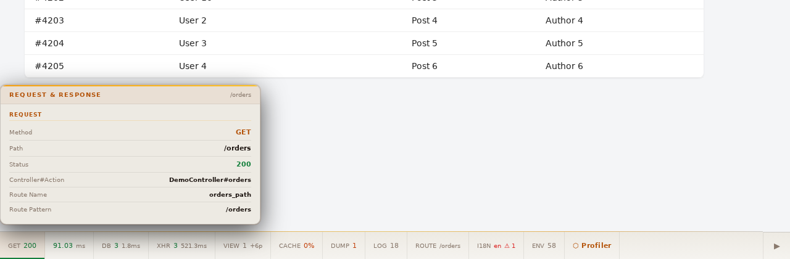

**Performance** (the duration item): duration, objects allocated, and the time the request
started.

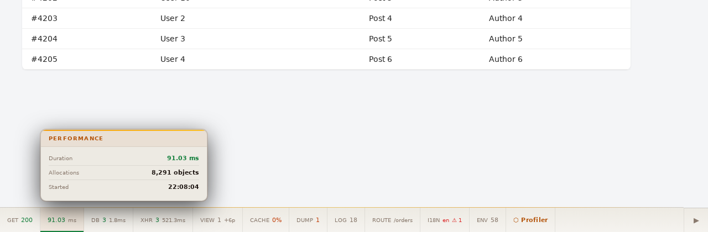

**Database**: query count and total time, then the first 10 queries with their model, duration
(red when slow) and SQL.

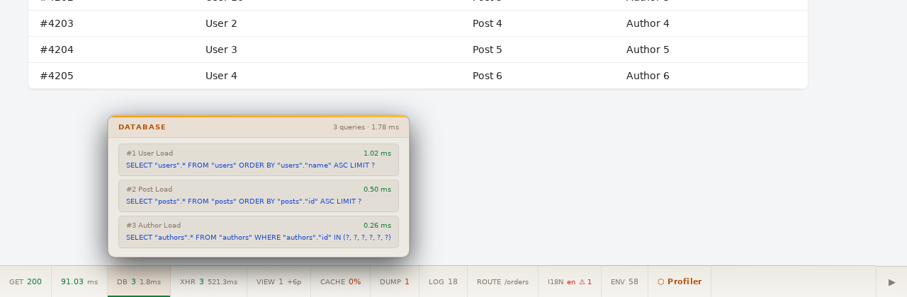

**AJAX**: request count and total time, then the first 10 requests with their method, path,
status and duration. A request made by Turbo for a `<turbo-frame>` carries a `FRAME` badge, one
answered with Turbo Stream actions a `STREAM` badge (see the [AJAX tab](#ajax-tab)).

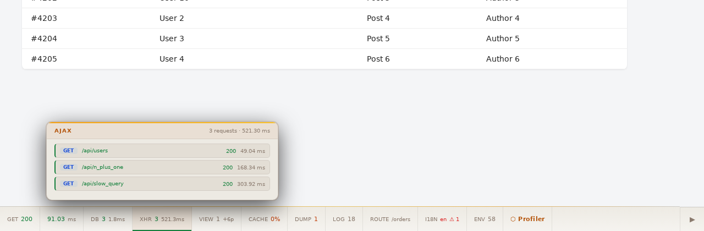

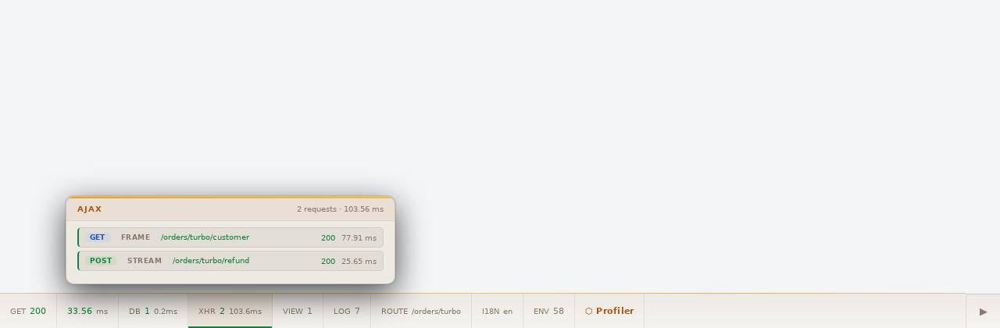

**Views**: total render time, then every template and every partial with its duration.

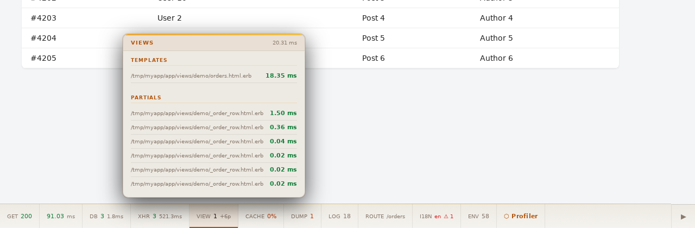

**Cache**: hit rate, reads, writes, hits and misses.

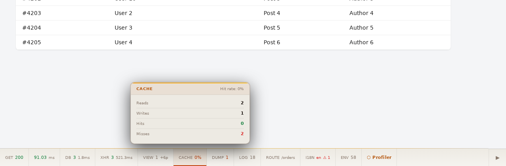

**Outbound HTTP**: request count and total time, then the first 10 calls with their method, host,
status (`ERR` for a call that got no answer) and duration; slow calls (500 ms or more) are marked
in red.

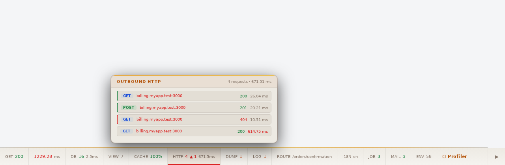

**Dumps**: the first 5 dumps, with their number, label, file and line, and the first line of the
value.

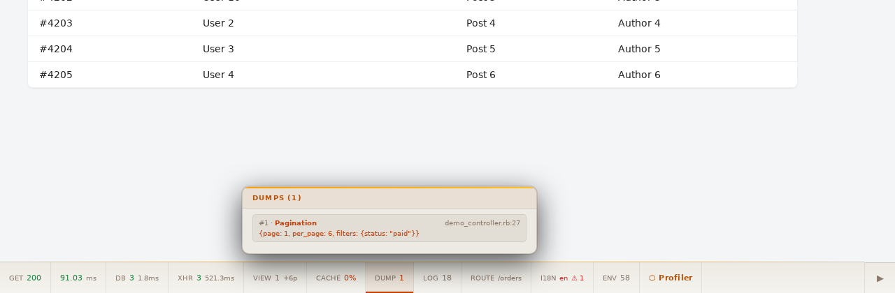

**Logs**: line count, error or warning count, then the last 5 lines, most recent first, with their
level.

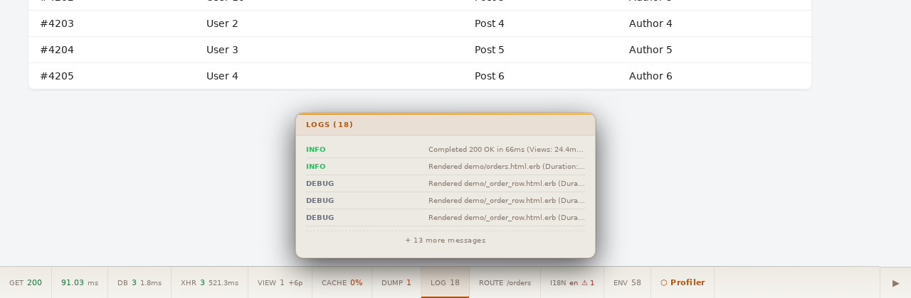

**Exception**: the exception class, its message and the first frame of the application in the
backtrace.

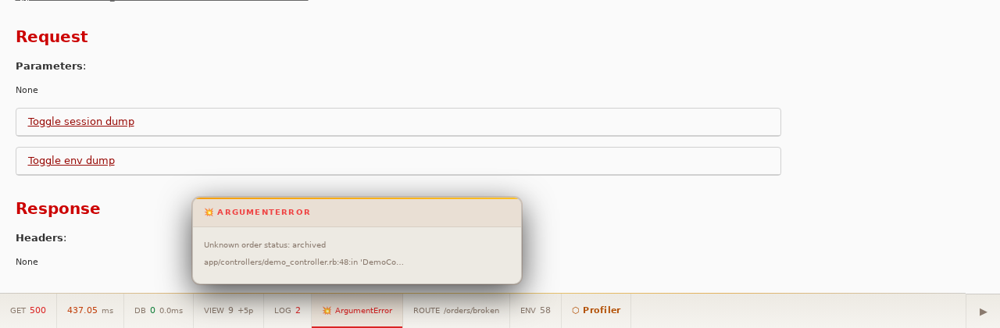

**Routes**: the number of routes, then the pattern, name and controller and action of the matched
route.

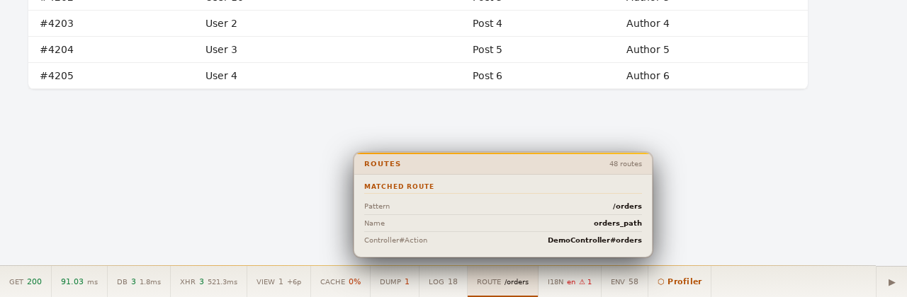

**I18n**: the locale and the number of missing keys, then 5 keys, missing ones first.

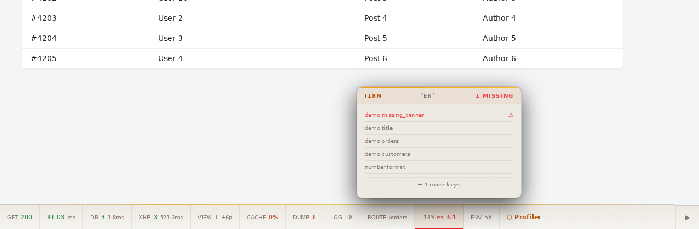

**Background Jobs**: the running count when some jobs run, the completed and failed counts, then
the first 5 jobs with their class and status: ✓ or ✗ and the duration once a job has ended, a
turning ◐ and `running` while it performs, with no duration. A job enqueued by the request is
listed as soon as it starts, and the panel updates when it ends, without a reload. While one of
its jobs runs, and none failed, the **JOB** item of the toolbar is blue with a ◐.

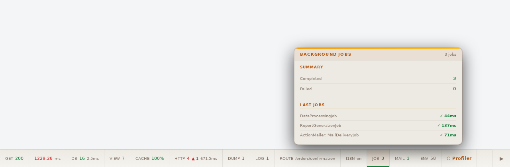

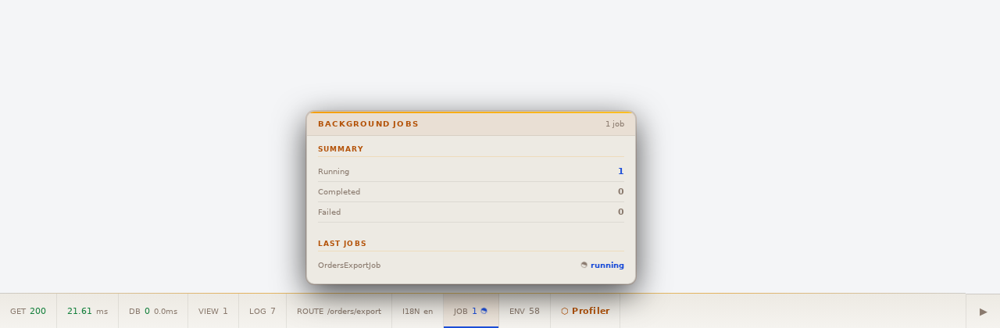

A job killed while it performs (process stopped by `SIGKILL`, out of memory, container shut down)
never saves its end: it stays `running` in the panel and in the profile list for good. Without
Redis storage, the toolbar of a page served by several Puma workers only sees its jobs start and
end when its polling reaches the worker that ran them; the jobs are listed on the next reload
otherwise.

**Mailers**: mail count, `deliver_now`, `deliver_later`, queued, multi-part and failed counts and
send loops when there are some, then the first 3 mails with their mailer and action, ✅ sent or ❌
failed.

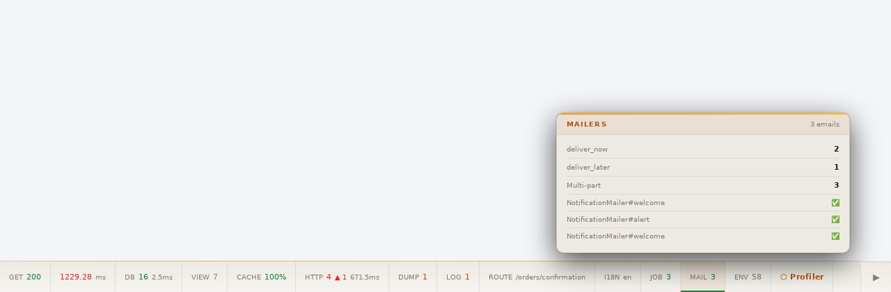

**Environment**: the number of `ENV` variables.

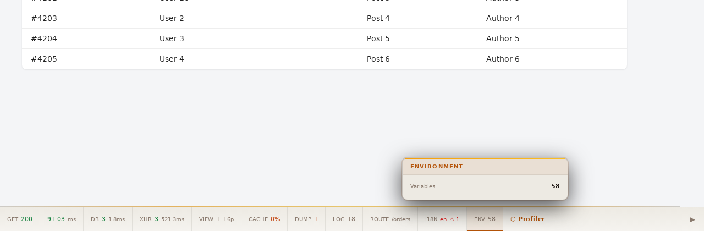

---

## Profiler Selector (Cluster)

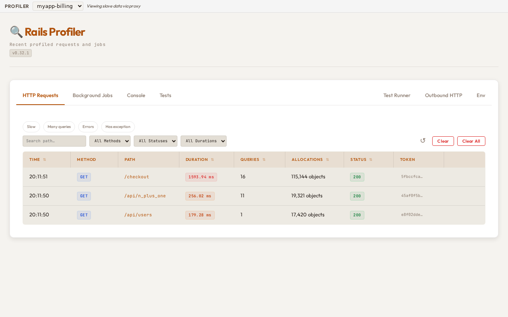

When the master profiler has slave instances connected, a **Profiler** dropdown appears at the
top of the `/_profiler` interface.

- **Local (master)**: shows profiles captured by the current instance (default)
- **\<slave name\>**: proxies all data through the master to the selected slave; the rest of the
  UI is identical, and "Viewing slave data via proxy" reminds you of it

Selecting a slave updates all profile lists, detail views, and actions so they operate on the
slave's data. The selection is remembered for the current browser session (sessionStorage).

Slaves appear as `(offline)` and cannot be selected if their last heartbeat is older than
`cluster_offline_threshold` (60 seconds by default). Setting up a cluster: [Cluster](cluster.md).

---

## Profile List


Navigate to `/_profiler` to see all recorded profiles. The header shows the version of the gem
that serves the page, and a ⚠️ next to a profile marks one recorded by another version. The list
is split into sections:

- **HTTP Requests**: regular web requests
- **Background Jobs**: Sidekiq and ActiveJob executions (see [Background Jobs](#background-jobs))
- **Console**: expressions evaluated in `rails console` (see [Console Profiles](#console-profiles))
- **Tests**: one profile per RSpec or Minitest example (see [Test Profiles](#test-profiles))
- **Test Runner**: runs your tests from the browser (see [Test Runner](#test-runner))
- **Outbound HTTP**: the outgoing calls of every profile (see
  [Outbound HTTP section](#outbound-http-section))
- **Env**: the `ENV` of the server process, which you can change (see [Env section](#env-section))

The section is kept in the URL (`/_profiler?section=jobs`), and so are the filters and the sort.
Clicking the tab of the current section reloads it.

### Filters

- **Quick presets**: Slow, Many queries, Errors, Has exception
- **Search**: filter by path substring
- **Method**: GET, POST, PUT, PATCH, DELETE
- **Status**: 2xx, 3xx, 4xx, 5xx
- **Duration**: under 100 ms, 100 ms or more, 500 ms or more

While a filter is active, the count of matching profiles shows next to the buttons.

### Columns

| Column | Description |
|--------|-------------|
| Time | Request timestamp |
| Method | HTTP verb badge |
| Path | Clickable link to profile detail |
| Duration | Color-coded response time |
| Queries | SQL query count |
| Allocations | Objects allocated while the request ran, by the whole process (other threads included on a multi-threaded server) |
| Status | HTTP status badge |
| Token | Unique profile identifier (click to copy) |

Column headers marked with ⇅ are sortable, and × at the end of a row deletes that profile.
**Clear** deletes the profiles of the section; **Clear All** deletes the HTTP, job and console
profiles, but not the test profiles, which the Tests section clears on its own. ↺ reloads the
list.

---

## Profile Dashboard

Clicking any row opens the **Profile Details** view with a tabbed interface. The header always
shows `METHOD PATH`, duration, status, allocations, start time and the version of the gem that
recorded the profile, with a warning when that version is not the one running. Request, Dump,
Database, Timeline, Views, Cache and Env are always there; the other tabs appear only when the
request has something to show in them. When the request raised, the Exception tab comes first and
opens by default. The open tab is kept in the URL (`?tab=database`).

### Request tab

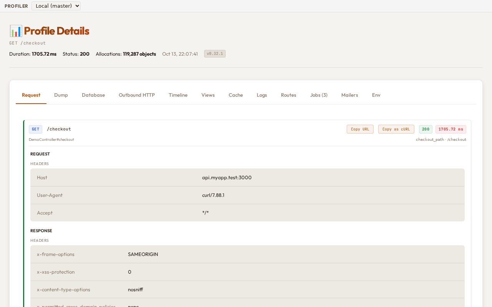

Shows the full HTTP context:

- **Method, path, status and duration**: core request metadata
- **Controller#Action**, and the route name and pattern it matched
- **Request**: headers, parameters and body
- **Response**: headers and body (compressed bodies are decoded automatically)
- **Copy URL** and **Copy as cURL**: replay the request from a terminal; both are built on
  `http://localhost:3000`, whatever the host the request was sent to
- **Truncation notes**: when a body was longer than `max_captured_body_bytes` and only its
  beginning was kept, or when the collectors of a long stream were released before it ended

Sensitive headers and parameters are already masked in the stored profile; see
[Sensitive data](security.md#sensitive-data).

---

### Dump tab

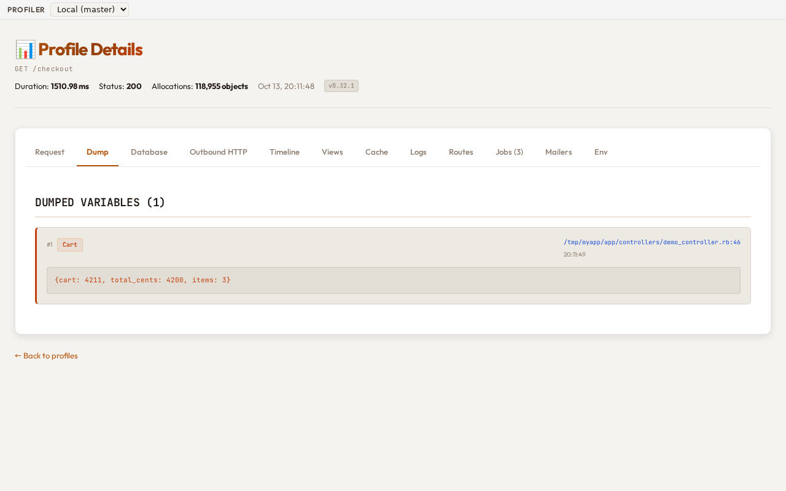

Shows all variables captured via `Profiler.dump()` during the request, in call order.

Each entry displays:
- **Number**: call order (#1, #2, ...)
- **Label**: optional human-readable label
- **File:line**: exact source location
- **Timestamp**: when the dump was captured
- **Value**: pretty-printed Ruby object

**Usage in code:**
```ruby
# Basic dump
Profiler.dump(@user)

# With a label
Profiler.dump(@posts, "Posts for current page")

# Chainable: returns the value
user = Profiler.dump(User.find(params[:id]), "Current user")
```

---

### Database tab


Displays all SQL queries executed during the request:

- **Summary**: total count, total duration, slow query count, cached query count
- **N+1 detection**: automatic warning when the same parameterized query is repeated 3 times or
  more, with the pattern highlighted and grouped, and the call stack behind ▾ backtrace
- **Query list**: each query shows:
  - Number, model name, execution time (color-coded)
  - SQL, with the bind values replaced by `?`
  - **N+1** badge when part of a detected pattern
  - **Explain** button: opens the query plan in a dialog

Slow queries (above `slow_query_threshold`, default 100 ms) are highlighted in red.

The **Explain** button only explains read-only queries, in a transaction always rolled back; any
other query is refused with the reason. See [Explaining a query](usage.md#explaining-a-query).

---

### AJAX tab

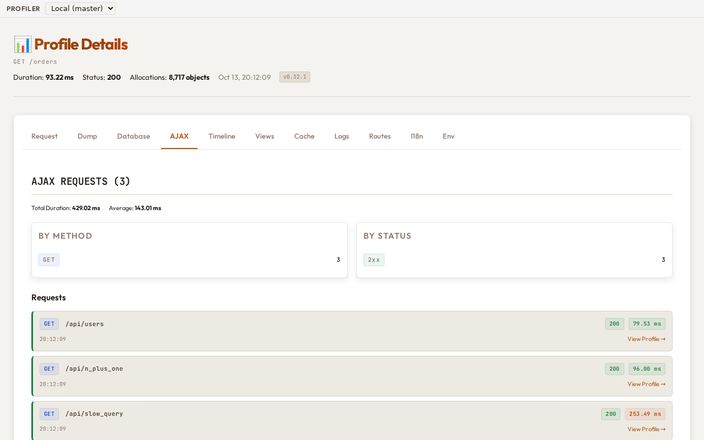

Lists the requests the page made with `fetch()` or `XMLHttpRequest` after it loaded. With
`config.track_ajax = true` (the default), the profiler adds a small script to each profiled page;
it reads the `X-Profiler-Token` header of every answer and links that profile to the page
(`POST /_profiler/api/ajax/link`). The profiler's own `/_profiler` requests are left out.

Turbo (Hotwire, 7 and 8) makes its requests with `fetch()`, so they go through the same script:

- a `<turbo-frame>` load, or a link or form aimed at a frame, is linked to the page and shown
  with a `FRAME` badge (Turbo sends the frame's id in the `Turbo-Frame` header, kept in the
  Request tab of its profile);
- a request answered with Turbo Stream actions (`text/vnd.turbo-stream.html`), such as a form
  submission, is linked and shown with a `STREAM` badge;
- a Turbo Drive visit, a link prefetched on hover, or a form submission answered with a page is
  not linked: it is the next page, which has its own profile and its own toolbar. The toolbar of
  the previous page is taken down when Drive renders the new one, and the requests the new page
  makes are linked to it.

Turbo Streams received over a WebSocket (`turbo_stream_from`) are not HTTP requests and are not
listed.

Two limits are known, both older than the Turbo support above:

- a Turbo 8 page refresh with morphing (`turbo_refreshes_with method: :morph`, or a model that
  `broadcasts_refreshes`) empties the toolbar, which keeps checking for updates of the profile of
  the page as first loaded, and the requests made after the refresh stay linked to that profile;
- after going back in the browser history, two toolbar containers are left in the page, only one
  of them visible.

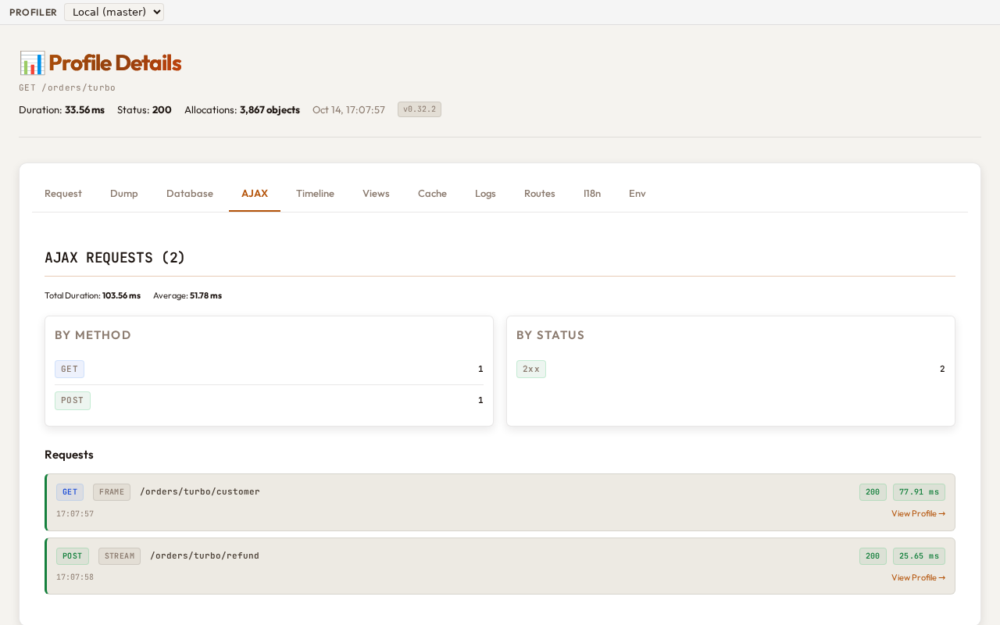

- **Summary**: number of requests, total and average duration
- **By Method** and **By Status**: counts per HTTP verb and per status class
- **Requests**: method, path, status, duration and time of each one, its `FRAME` or `STREAM`
  badge for a Turbo request, with **View Profile** to open its own profile

The tab is computed when the page is shown, from the requests linked to it, so it appears as soon
as one is linked, after the page itself was saved. The jobs a page enqueued are listed in the
[Jobs tab](#jobs-tab), not here. The MCP tool `get_profile_ajax` returns the same list.

---

### Outbound HTTP tab

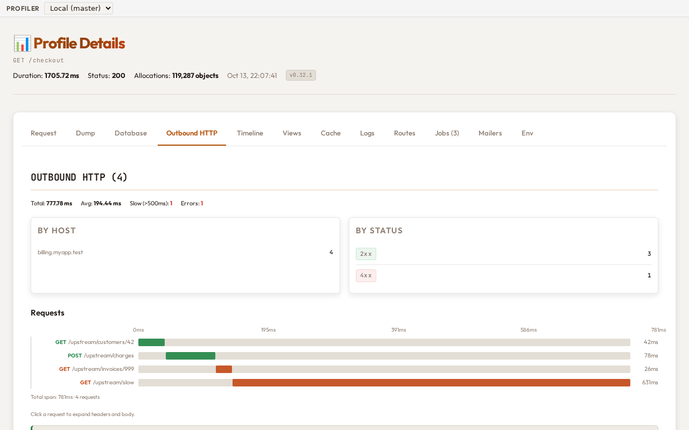

Tracks all outbound HTTP calls made via `Net::HTTP` (so Faraday, RestClient, HTTParty and the like):

- **Summary**: total count, total duration, average duration, slow count (above
  `slow_http_threshold`, 500 ms by default), error count
- **By Host**: request count grouped by domain
- **By Status**: count grouped by HTTP status class (2xx, 3xx, 4xx, 5xx)
- **Requests**: a waterfall of the calls on the request's time line, then each call with its
  method, URL, status, duration and sizes; click one to expand its headers and bodies

---

### Timeline tab

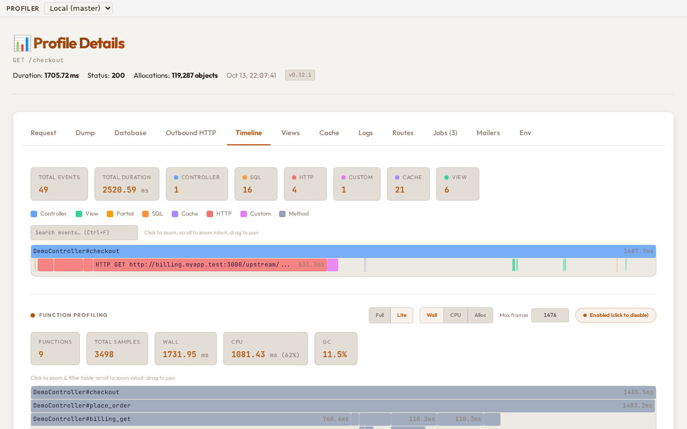

A hierarchical flame graph of all instrumented events during the request:

- **Summary chips**: total events, total duration, count per category
- **Legend**: Controller, View, Partial, SQL, Cache, HTTP, Custom, Method
- **Interactive canvas**:
  - Click a block to zoom in, **Reset Zoom** to go back
  - Scroll to zoom in/out
  - Drag to pan
  - Hover for tooltip with name, duration, and payload
- **Search** (Ctrl+F): highlight matching events across the graph, with the number of matches
- **Breadcrumbs**: navigation trail when zoomed in

**Custom instrumentation** via `Profiler.measure()`:
```ruby
result = Profiler.measure("payment.stripe_charge", metadata: { amount: 1000 }) do
  Stripe::Charge.create(amount: 1000, currency: "usd")
end
```

Custom events appear nested at the correct position in the hierarchy. The
[Function profiling](#function-profiling) section follows the flame graph, in the same tab.

A profile recorded before 0.9.1, which has no flame graph data, shows a plain list of its events
instead ("Performance Timeline"), each with its duration and payload.

---

### Function profiling

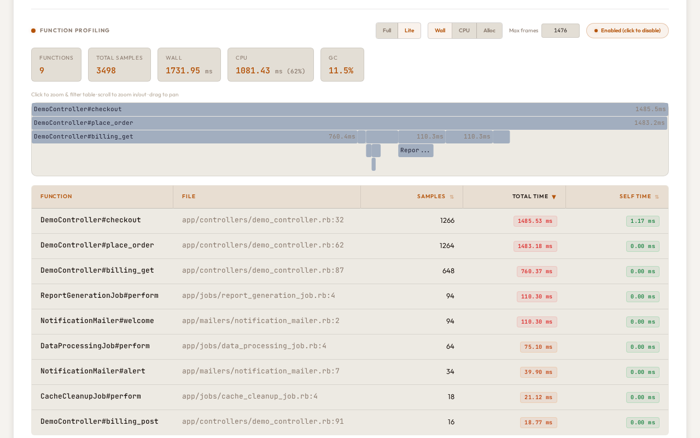

Below the flame graph of the [Timeline tab](#timeline-tab), function profiling shows the Ruby
methods the request spent its time in, as a second flame graph and a table.

- **Controls**: they change the settings of the process that serves the page, for the next
  requests: **Full** or **Lite** mode, the **Wall**, **CPU** or **Alloc** clock of lite mode,
  **Max frames**, and **Enabled** or **Disabled**
- **Summary**: functions, then samples (lite mode) or calls (full mode), wall time (the
  allocations with the Alloc clock), and in lite mode the CPU time and its share of the wall
  time, and the share of garbage collection; full mode adds the objects allocated and the
  memory
- **Flame graph of the functions**: click a frame to zoom in and to filter the table to that
  function and the functions it called (**✕ Clear** removes the filter)
- **Table**: function, file and line, samples or calls, total and self time (total and self
  allocations with the Alloc clock), and in full mode objects and memory; every numeric column
  is sortable, and ↺ marks a recursive function
- **Frame cap**: a warning when the call tree was cut at **Max frames**

Lite mode needs the `stackprof` gem in the application's `Gemfile`; without it the section says
so. See [Configuration](configuration.md#function-profiling) and what each mode costs in
[Performance](performance.md#function-profiling).

---

### Views tab

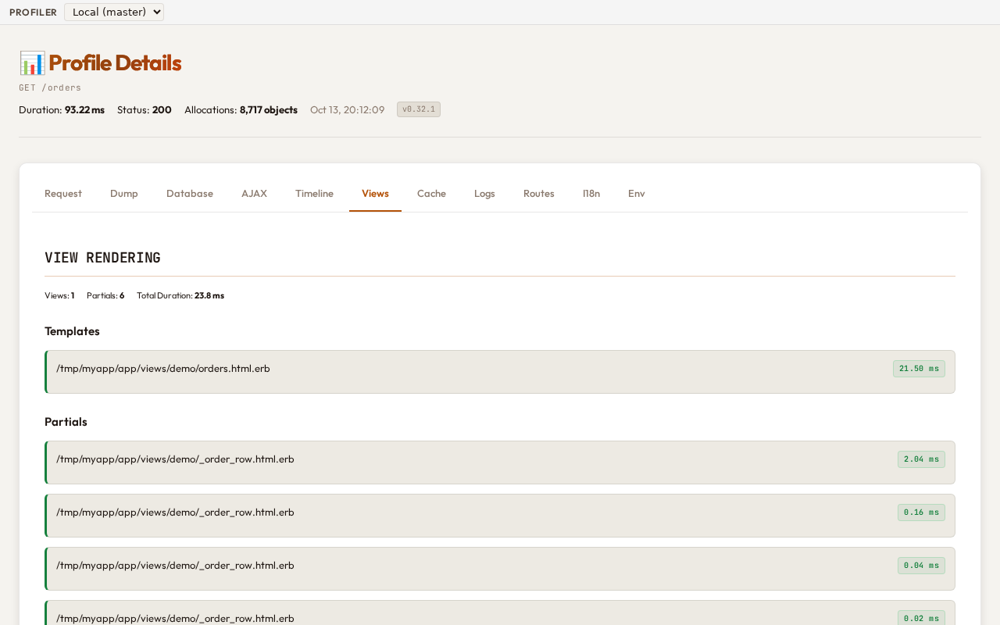

Shows template and partial rendering:

- **Summary**: view count, partial count, total render duration
- **Templates**: each rendered template with its file path and duration
- **Partials**: each rendered partial with its file path and duration

Every duration shows in a green badge, whatever its value: this tab does not mark slow templates.
A collection rendered with `render partial: ..., collection: ...` is one Action View event of its
own, which this tab does not count as partials.

---

### Cache tab

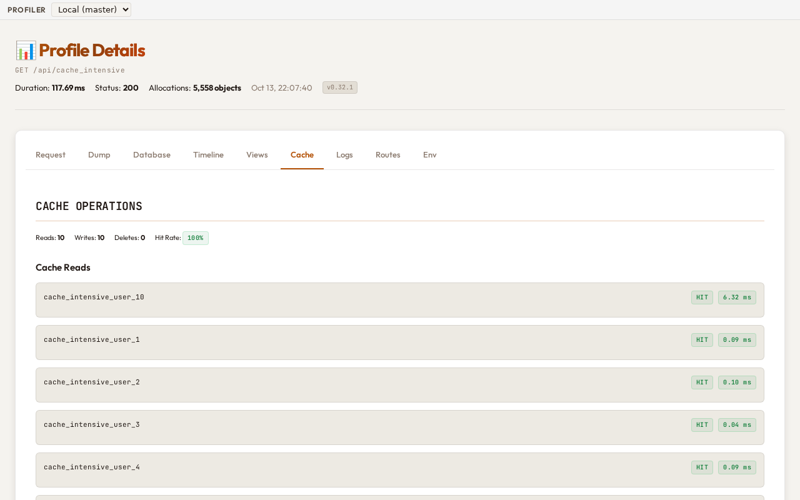

Monitors all Rails cache operations:

- **Summary**: read count, write count, delete count, hit rate %
- **Cache Reads**: each key read, with a HIT or MISS badge and its duration

Writes and deletes are counted in the summary but not listed. The hit rate is green above 80%,
yellow otherwise.

---

### Logs tab

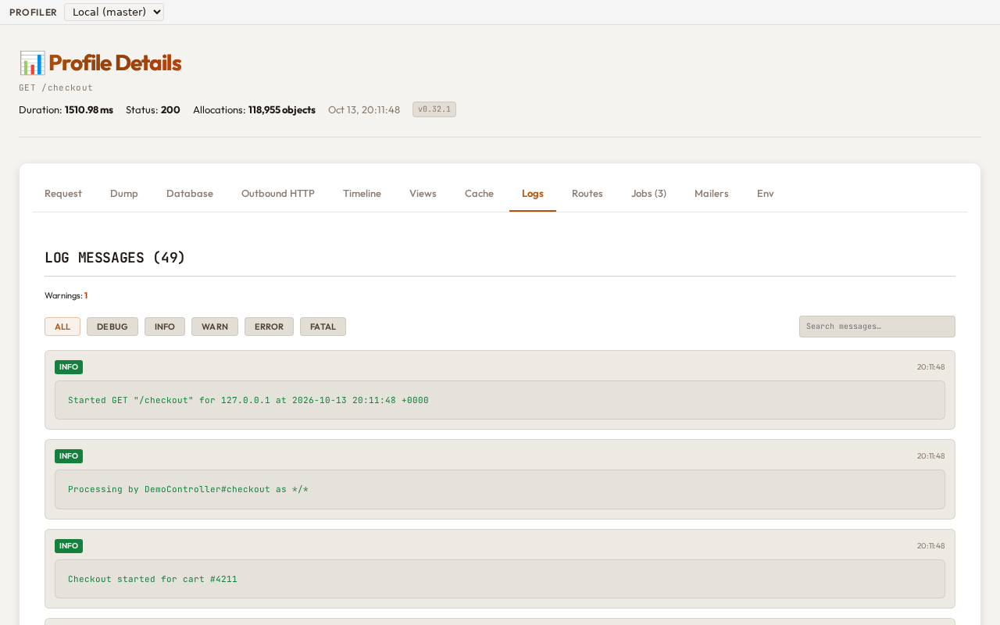

Captures the log output generated during the request, up to `max_captured_log_bytes` (1 MB by
default; past it, the tab ends with the number of lines left out):

- **Summary**: error count, warning count
- **Level filter**: ALL, DEBUG, INFO, WARN, ERROR, FATAL
- **Search**: filter the messages by substring
- **Log entries**: timestamp, level badge (color-coded), message

---

### Routes tab

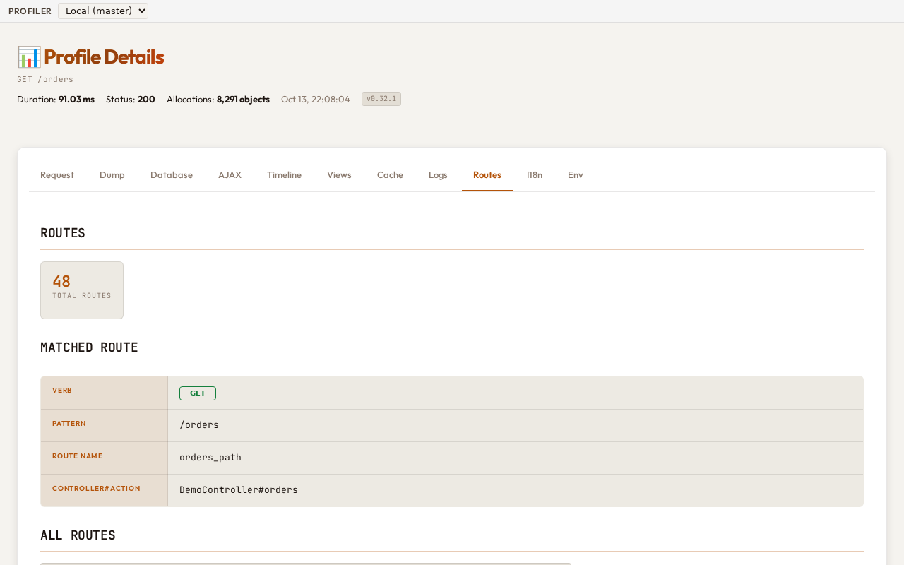

Shows the routes registered in the Rails app:

- **Total routes**
- **Matched route**: verb, pattern, route name and controller#action
- **All routes**: HTTP verb, URL pattern, controller#action, route name, with a filter on the
  path, the name or the controller; the matched route is highlighted

The profile keeps only the route its request matched. The table is the one of the process that
serves the page, as it is now (rebuilt when the routes are reloaded in development).

---

### I18n tab

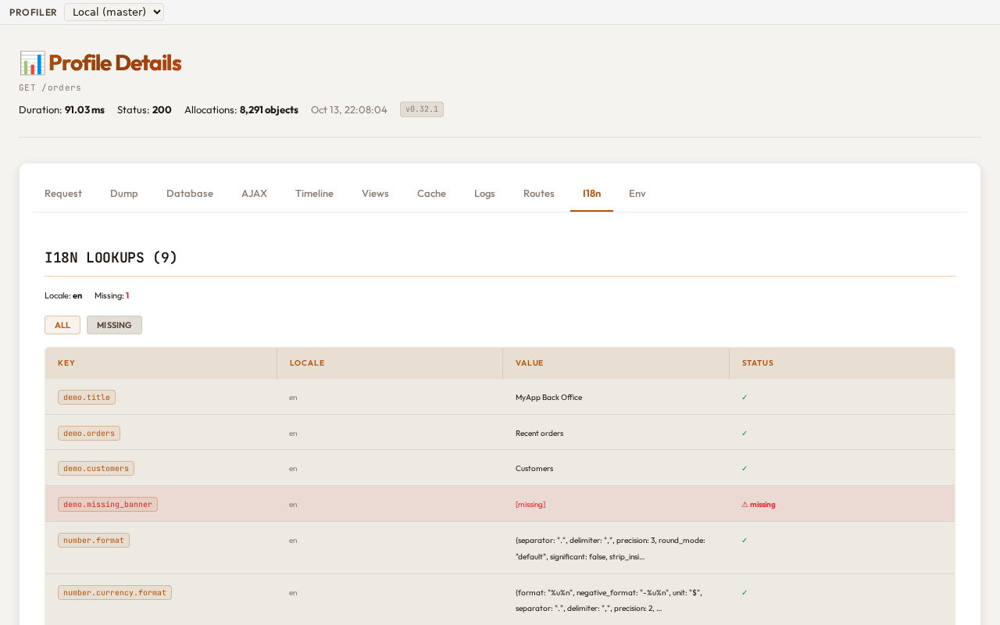

Tracks all translation lookups during the request:

- **Summary**: locale, missing key count
- **Filter**: ALL / MISSING only
- **Table**: key, locale, resolved value, status (✓ found / ⚠ missing)

Missing keys are highlighted in red, which helps catch untranslated strings before they reach
production.

---

### Jobs tab

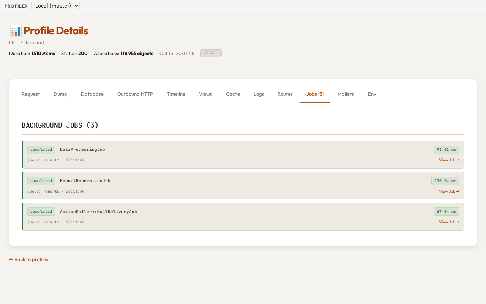

Appears when the request enqueued background jobs (ActiveJob, Sidekiq), mails sent with
`deliver_later` included: class, queue, status, duration and time of each job, with **View Job**
to open its own profile (see [Background Jobs](#background-jobs)).

---

### Mailers tab

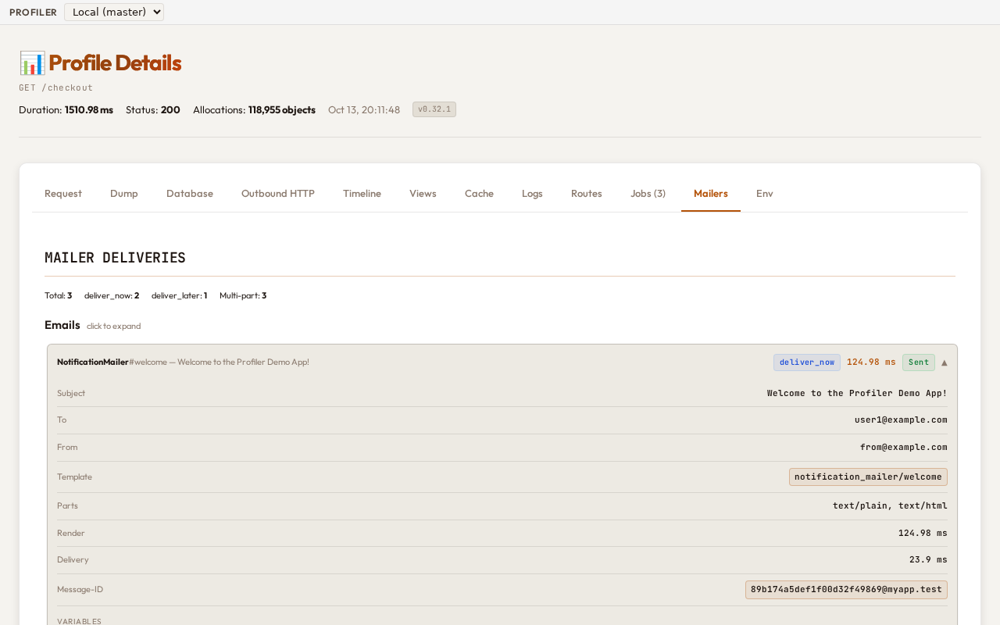

Appears when the request delivered or queued mail through ActionMailer
(`config.track_mailers = true`, the default):

- **Summary**: total, `deliver_now` and `deliver_later` counts, mails queued, multi-part mails,
  errors
- **Send loop warning**: the same mailer action called more than three times in one request
- **Emails**: one row per mail (mailer class, action, subject, delivery mode, render time, sent or
  error); click it to expand subject, recipients (To, From, CC, BCC, Reply-To), template, parts,
  attachments, render and delivery times, Message-ID, the mailer's instance variables and the
  body
- **Body**: HTML preview (in a sandboxed frame, without scripts), HTML source or plain text, only
  with `config.capture_mail_body = true`; otherwise the row says how to turn it on
- **Queued**: mails enqueued with `deliver_later` during the request, sent later by a job
- **Delivery Errors**: mails whose delivery raised

Only the first 50 mails of a request are kept, and the tab says so when there were more.
`config.sanitize_mailer_recipients = true` masks the addresses, and
`config.mailer_skip_actions` leaves mailers or actions out (see [Usage](usage.md#mailers)). The MCP
tools `get_profile_mailers` and `query_mailers` read the same data.

---

### Env tab

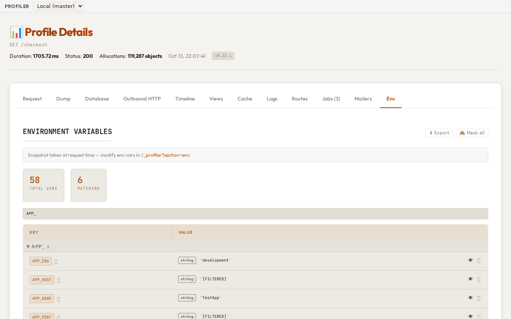

Lists the `ENV` variables, grouped by prefix, with a filter on names and values. Values outside
`config.env_allowlist`, and any value whose name matches the filter of sensitive data, are
`[FILTERED]` on the server; the eye icons only hide or show values on screen. **Export** saves
the variables the filter shows as a `.env` file.

The Env tab of an HTTP profile shows the current `ENV` of the process that serves the page, not
the `ENV` as it was during the request (the hint above the table says "Snapshot taken at request
time", which is only true of jobs and console expressions). The profile of a job, a console
expression or a test keeps the `ENV` of the process it ran in; the tab shows it for jobs and
console expressions, not for tests (see [Test Profiles](#test-profiles)). To change variables,
use the [Env section](#env-section).

---

### Exception tab

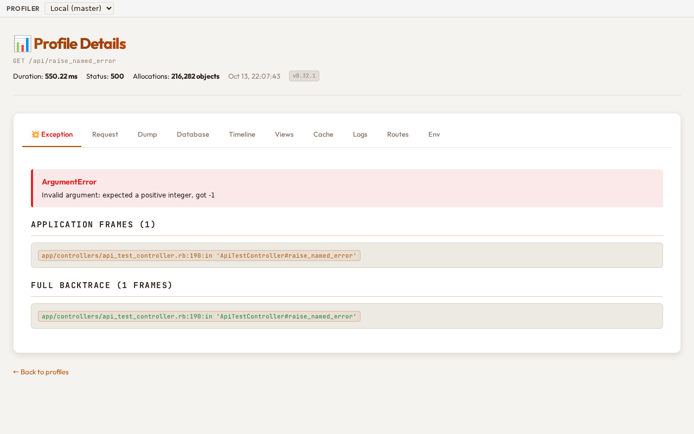

Appears, first and selected, when an exception occurred during the request:

- **Exception class** and message (highlighted in red)
- **Application frames**: only frames from your application code
- **Full backtrace**: the first 30 frames, application frames highlighted, and **Show all**
  for the rest

---

## Background Jobs

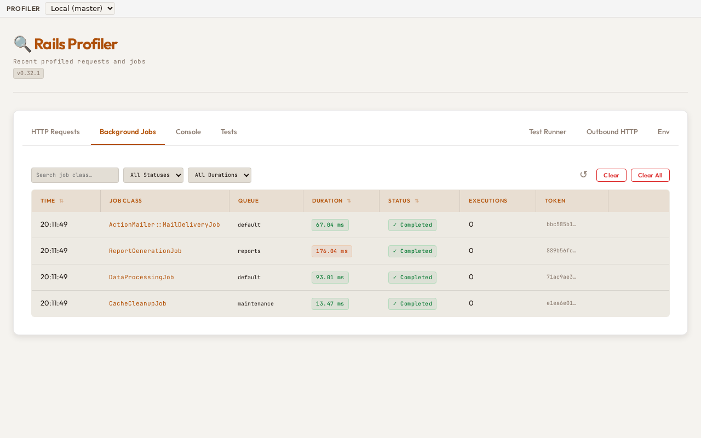

Background jobs (Sidekiq, ActiveJob) are profiled separately and appear under the **Background
Jobs** section of the profile list: time, job class, queue, duration, status (Running, Completed
or Failed), executions and token, with a search on the class and filters on status and duration. A
job still running has a blue **Running** badge and no duration, and the **Completed** filter
leaves it out.
See [Usage](usage.md#background-jobs).

### Job profile

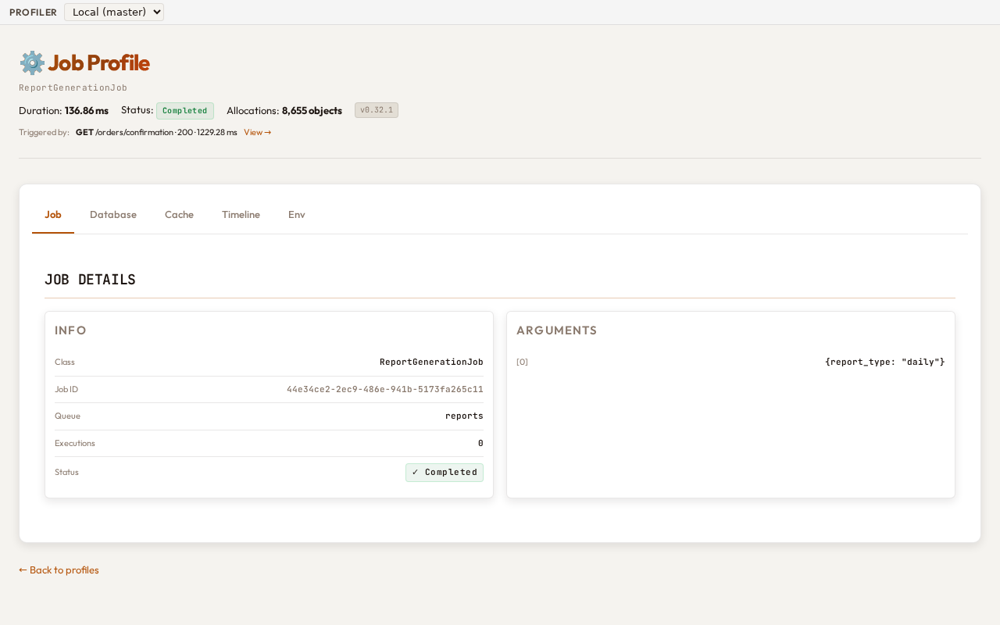

Clicking a job, in this list or with **View Job** in the [Jobs tab](#jobs-tab) of a request, opens
its **Job Profile**. The header shows the job class, duration, status (Completed or Failed),
allocations and version, and, under **Triggered by**, the request or the job that enqueued it
with a **View** link to its profile.

The **Job** tab opens first, unless the job raised: class, job ID, queue, executions and status,
then the arguments (masked like request parameters) and, for a failed job, its error. Next to it,
**Database**, **Cache**, **Timeline** and **Env** are always there, and **Outbound HTTP**, **Jobs**
(the jobs it enqueued in turn), **Dumps**, **Mailers** and **Exception** appear when the job has
something to show in them; a job that raised opens on its Exception tab. As of 0.32.1 the **Logs**
tab does not appear on a job profile, although its log lines are recorded: the dashboard looks for
a field the log collector does not write. Adding `?tab=logs` to the URL of the job profile still
shows them.

---

## Console Profiles

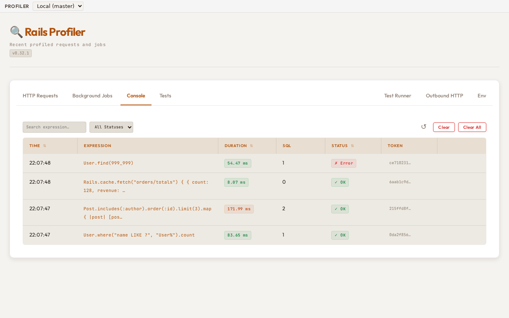

Expressions evaluated in `rails console` are profiled automatically when `track_console: true`
(default) and appear under the **Console** section; see
[Console profiling](usage.md#console-profiling).

### Columns

| Column | Description |
|--------|-------------|
| Time | When the expression was evaluated |
| Expression | The Ruby expression (truncated to 60 chars) |
| Duration | Evaluation time, color-coded |
| SQL | Number of SQL queries executed |
| Status | ✓ OK or ✗ Error |
| Token | Unique profile identifier (click to copy) |

Column headers marked with ⇅ are sortable. The Expression column is filterable by substring; a
Status filter lets you show only errors or successes.

### Console profile

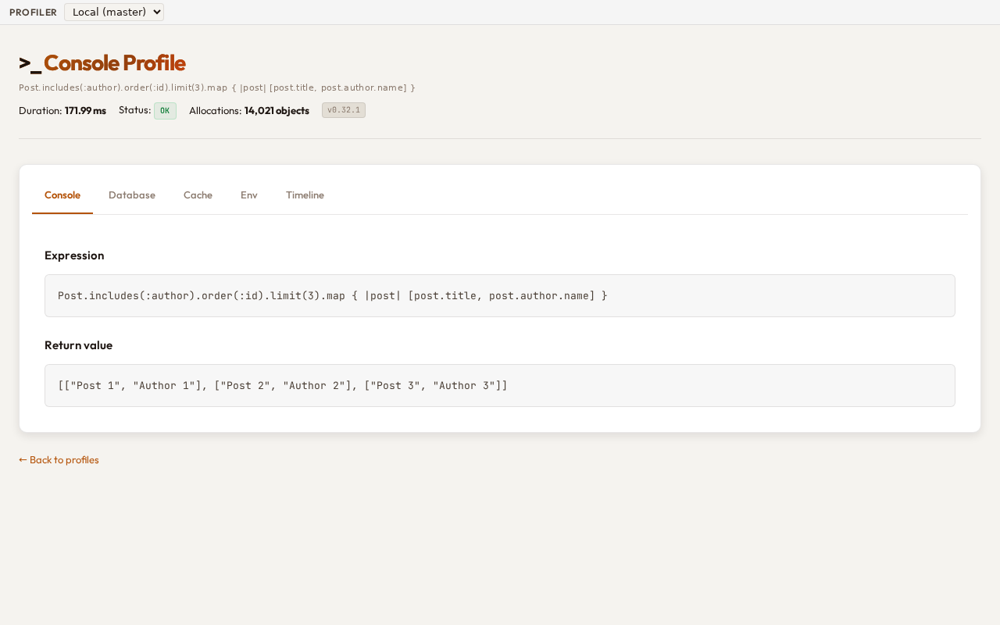

Clicking an expression opens its **Console Profile**: the expression in the header, duration,
status (OK, or Error when the expression raised), allocations and version.

The **Console** tab opens first, with the **Expression** and its **Return value** (as `inspect`
shows it, up to 10,000 characters). **Database**, **Cache**, **Env** and **Timeline** are always
there, and **HTTP** (the outbound calls), **Dumps** and **Exception** appear when the expression
made some; an expression that raised opens on its Exception tab. As for jobs, the **Logs** tab
does not appear on a console profile as of 0.32.1.

### Env overrides

Environment variable overrides set via the profiler UI or MCP tools are applied before each
expression evaluation, so changes take effect immediately in the open console without a restart.
They are applied only outside production and while the profiler is enabled, unless
`config.apply_env_overrides_when_disabled = true` (never in production); see
[Environment variable overrides](usage.md#environment-variable-overrides).

---

## Test Profiles

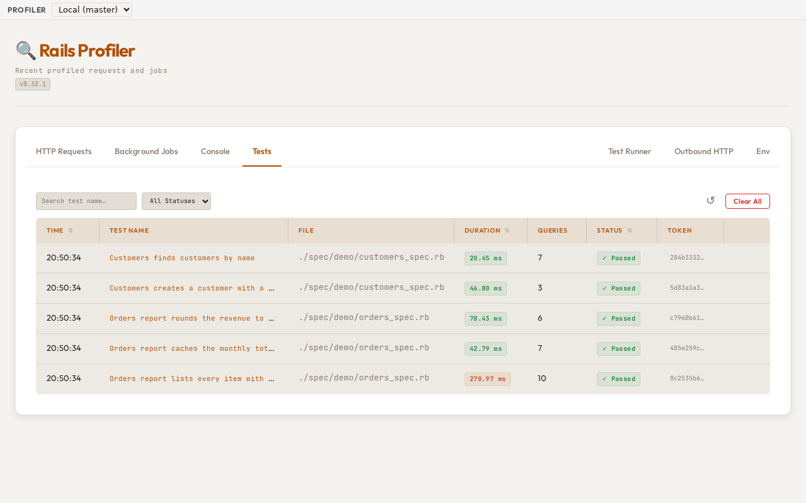

With test profiling set up (see [Tests](testing.md)), every example of a suite run from the
shell or from the [Test Runner](#test-runner) is listed under the **Tests** section: time, test
name, file, duration, query count, status and token, with a search on the test name and a
status filter (Passed, Failed, Pending). Its **Clear All** deletes the test profiles only.

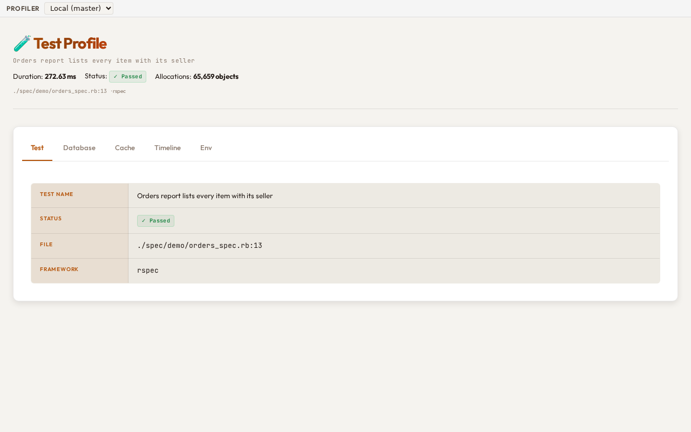

A test profile shows the test name, duration, status, allocations, and the file, line and
framework in its header, and opens with its own tabs:

- **Test**: test name, status, file and line, framework, assertions (Minitest), skip reason and
  exception message
- **Database**, **Cache** and **Timeline**: as for a request, so an N+1 in a test shows the same
  way as in a page

  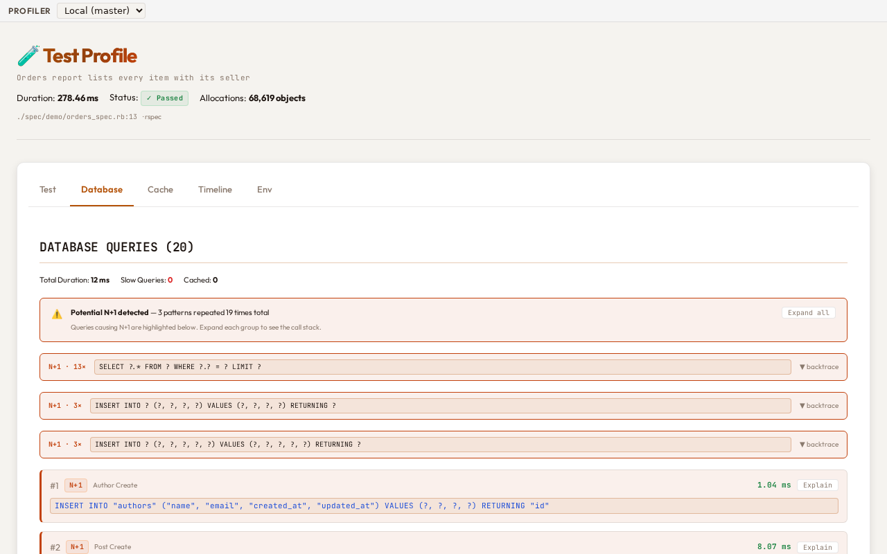

- **Exception** when it raised
- **Env**: the profile keeps the `ENV` of the test process, but as soon as the tab opens it reads
  the `ENV` of the server process again and shows that one instead; unlike the other profiles, it
  also shows the editing buttons of the [Env section](#env-section), which act on the server
  process, not on the test

The test profiler records neither `Profiler.dump()` calls nor log lines, so a test profile never
has a **Dumps** or a **Logs** tab.

The MCP tools `query_test_profiles` and `get_test_profile`, and the resources
`profiler://slow-tests` and `profiler://failing-tests`, read the same profiles.

### Test Runner


The **Test Runner** section (`/_profiler/test_runner` redirects to it) runs your tests in the
`test` environment, from the browser:

- **RSpec** or **Minitest**, when the application has both
- **The file tree** of the discovered test files (`spec/**/*_spec.rb`, `test/**/*_test.rb`),
  grouped by directory: tick files or whole directories, click a directory to fold it, or use
  **All** / **None**; the count of selected files shows next to them
- **▶ Run Selected** starts the run, **■ Stop** kills it
- **The output** of the run, streamed live with its colors, followed by the profiler's report
  (slowest tests, N+1 patterns); above it, the status of the run (Running, Passed, Failed, Killed
  or Error) and its duration, and, once it passed or failed, **View in Profiler** to open the
  Tests section

Only discovered files can be run, and the environment of the test process follows the rules of
[Test runner](testing.md#test-runner). The MCP tool `run_tests` starts the same runs.

---

## Outbound HTTP section

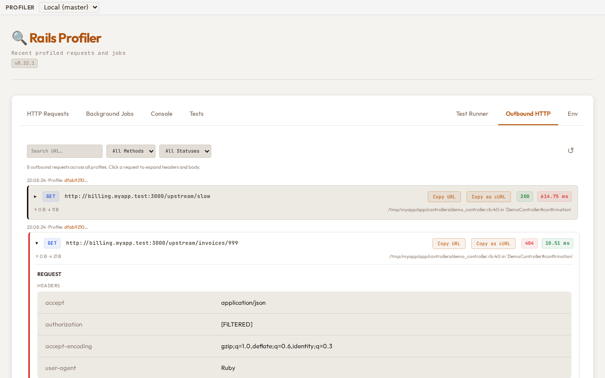

**Outbound HTTP** lists the outgoing calls of every profile in one place, most recent first:
each call with the time and a link to the profile that made it, its method, URL, status,
duration, sizes and the line of code behind it, and **Copy URL** and **Copy as cURL**. A search on
the URL and filters on method and status (2xx to 5xx, or Error for a call that got no answer)
narrow the list; click a call to see its headers and bodies.

---

## Env section

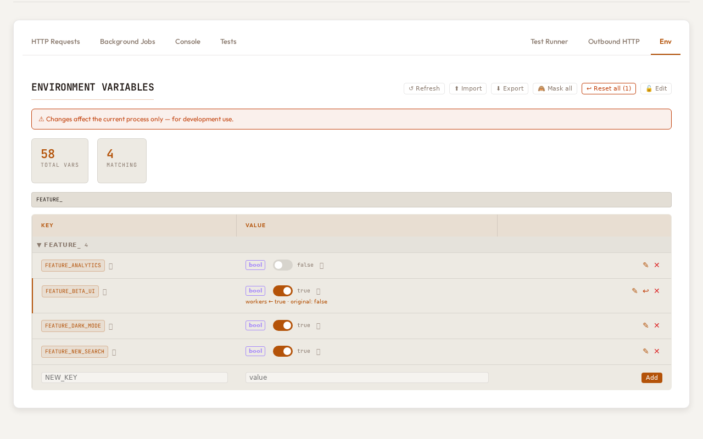

**Env** lists the `ENV` of the server process, grouped by prefix with a filter on names and
values, and changes it:

- **Edit** a value with ✎ (or a click on it), switch a `true`/`false` value with its toggle,
  delete a variable with ✕, or add one in the last row
- **↩** resets a changed variable to its original value, and **↩ Reset all** every change
- **⬆ Import** applies the content of a `.env` file pasted in a text box; values exported while
  masked are skipped
- **⬇ Export** saves the variables the filter shows as a `.env` file
- **↺ Refresh** reads the variables again, and **🔓 Edit** / **🔒 Locked** turns editing off
  and on
- a changed variable shows its new value and its original one below it

Values outside `config.env_allowlist`, and values whose name matches the filter of sensitive
data, are `[FILTERED]`, as in the [Env tab](#env-tab). Changes are saved as overrides under
`tmp_path` and applied again at boot, before each job and before each console expression, with the
rules of [Environment variable overrides](usage.md#environment-variable-overrides). The MCP tools
`list_env_vars`, `set_env_var`, `delete_env_var`, `reset_env_var` and `reset_all_env_vars` do the
same.
